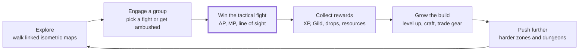
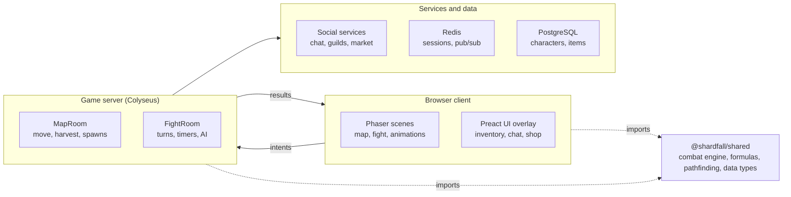
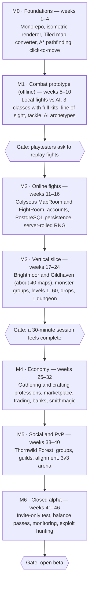

# Shardfall — Game Design Document

Last updated: 2026-10-28

This is the repository copy of the design doc. Change it here, in the same pull request as the code it affects, so the design and the game stay in step.

## Overview

Shardfall is a browser-based, turn-based tactical MMORPG on an isometric grid, built in Phaser + TypeScript. Its systems follow the Dofus model closely (AP/MP combat on the exploration map itself, characteristic points, item sets, harvest-and-craft professions, a player-driven economy), while the world, classes, names and art are entirely original.

**Design pillars**

- **Every fight is a puzzle.** Positioning, line of sight, tackle and initiative matter more than raw stats.
- **Builds are personal.** Characteristic points, equipment rolls and spell variants let two players of the same class play very differently.
- **Players make the economy.** Almost every item worth having is harvested, crafted or dropped by players and sold on player marketplaces.
- **Play together, or alone with friends.** Groups of up to 8 fight together; a single player can control several characters on one account.

**Target audience:** players aged 16+ who like tactics games (Into the Breach, Wakfu, XCOM) and long-term MMO progression; sessions of 20–90 minutes on desktop browsers first, tablets later.

**Launch scope.** The first release is deliberately small: **3 classes, 3 regions, level cap 60**, and a lean combat ruleset in the spirit of the 2005–2009 era (no erosion, no pushback damage). Everything else in this document that sits outside that scope is marked *later*; the systems are built so classes, regions and levels can be added as data.

**Core loop:** explore a map → engage a monster group → win the tactical fight → earn XP, currency and resources → level up, craft or buy better gear → take on harder zones and dungeons.



Each pass through the loop ends with a stronger character facing harder content; the fight is the only step that cannot be skipped.

## World and setting

The Shardlands are an archipelago formed when the Heartcrystal, a world-sized gem, shattered. Its fragments (Shards) now grant power to whoever carries them, and every class draws on one of these fragments. The tone is light, colourful and humorous, with darker stakes in late-game zones.

**Regions (launch set)**

| Region | Level range | Character |
| --- | --- | --- |
| Brightmoor Isle | 1–15 | Tutorial island, farm fields, the first village |
| Gildhaven | 10–60 | Neutral capital: marketplaces, profession workshops, Waystone hub |
| Thornwild Forest | 20–60 | Dense woods, beast and fungus monsters |

**Later regions**, each raising the level cap when it arrives: Saltreach Coast (fishing towns, pirate camps, sea caves), Emberveld (volcanic badlands, mining, fire elementals), Frostmere Peaks (glacier passes, high-level dungeons) and The Fracture (the unstable zone around the Heartcrystal's core, end-game bosses).

**Alignment factions.** Two rival city-states, Dawnspire (order, light) and Gloamhold (ambition, shadow), recruit players at level 10. Alignment unlocks PvP, territory control and faction quests (see Economy and social).

**Lore hooks.** Each region tells part of why the Heartcrystal broke; dungeon bosses guard major Shards; seasonal events reveal new fragments and add a temporary map set.

## Characters

Players pick one of 3 original classes at launch, each built around a role and 2–3 of the four damage elements; more classes come later. Elements map to characteristics: **Earth = Strength, Fire = Intelligence, Water = Chance, Air = Agility**, plus Neutral (scales with Strength).

### Classes

**Launch classes**

| Class | Role | Main elements | Signature mechanic |
| --- | --- | --- | --- |
| Vanguard | Melee damage | Earth, Air | Leaps onto targets; bonus damage after moving |
| Longshot | Ranged damage | Air, Fire | Long range, damage grows with distance |
| Mender | Healer | Fire, Water | Heals that also grant AP; resurrects once per fight |

**Later classes** (ideas to keep, not in the launch scope):

| Class | Role | Main elements | Signature mechanic |
| --- | --- | --- | --- |
| Warden | Tank | Earth, Fire | Shields allies, redirects damage to self |
| Tidecaller | Control mage | Water, Air | Push and pull; water puddles slow enemies |
| Hexweaver | Debuffer | Water, Air | AP/MP removal, curses that spread on death |
| Shepherd | Summoner | Earth, Water | Up to 4 beast summons with their own turns |
| Gambit | Luck | All four | Dice rolls pick the element and bonus of each hit |
| Clockwright | Traps and glyphs | Fire, Air | Places traps and turret glyphs; triggers chain reactions |
| Bloodsworn | Berserker | Earth, Fire | Spends own HP for damage; stronger below 50% HP |
| Shiftblade | Positioning | Air, Water | Teleports and swaps places with any unit |
| Mirelord | Damage over time | Water, Earth | Poisons that tick each turn and stack |

### Characteristics

| Characteristic | Effect |
| --- | --- |
| Vitality | +1 max HP per point |
| Wisdom | +1% XP per 10 points; raises AP/MP parry and removal |
| Strength | +1% Earth and Neutral damage per point; +5 pods (carry weight) |
| Intelligence | +1% Fire damage and heals per point |
| Chance | +1% Water damage per point; +1 Prospecting per 10 points |
| Agility | +1% Air damage per point; +1 Dodge and Lock per 10 points |

**Derived and secondary stats:** HP (55 + 5 per level + Vitality), AP (base 6; a 7th at level 100 once the cap allows it), MP (base 3), Range, Initiative, Prospecting, Dodge, Lock, AP/MP Parry, AP/MP Removal, Critical %, Critical Damage, Power, flat Damage per element, Heals, Summons, and per-element resistances (% and flat).

### Leveling

- Levels 1–60 at launch; each later region raises the cap. The XP curve is exponential.
- Each level grants **5 characteristic points**. Cost per point rises with the current value: 1 point each up to 100, 2 up to 200, 3 up to 300, 4 beyond. Vitality always costs 1; Wisdom costs 3.
- **Scrolls** found in the world add permanent base points (up to 100 per characteristic) without spending level points.
- Players can reset characteristics for free at level-up milestones (levels 20, 40 and 60) or with a consumable.
- Spells unlock by level (see Spells); there are no spell points to spend.

## Tactical combat

Fights happen on the same isometric map the players were exploring: the map locks, obstacles stay, and every unit takes turns spending Action Points (AP) on spells and Movement Points (MP) on steps.

### Grid

- Each map is a staggered isometric grid of **14 cells across × 40 staggered lines (560 cells)**, stored as a 1D array with flags: walkable, line-of-sight blocking, start cell (team A / team B), interactive.
- Movement is 4-directional along grid axes (diagonal on screen). One cell costs 1 MP. Distance between cells is Manhattan distance in grid coordinates.

### Fight sequence

1. **Engage.** A player attacks a monster group, or an aggressive group attacks the player. Other players can join until placement ends (a lock option blocks joins).
2. **Placement (30 s).** Each unit starts on a random free cell among its team's coloured start cells, then can move to another one. Moving onto an ally's cell swaps the two.
3. **Turn order.** Units are sorted by Initiative, alternating teams: highest of team A, highest of team B, and so on. The team whose best unit has the higher Initiative opens; when one team runs out of units, the rest of the other team follows. Ties are broken by the fight's seeded RNG. The order is fixed for the whole fight: dead units keep their slot (so they can be revived) and are skipped.
4. **Turns (30 s each).** At turn start, the unit's AP and MP refill, then buffs and poisons tick and durations decrement. The unit casts spells (AP), moves (MP) and ends its turn. Unused AP and MP are lost. A round ends when the order wraps around.
5. **End.** A team wins when every opponent is dead or has fled. If both teams are wiped out by the same action, the fight is a draw. Rewards are rolled and the map unlocks.

**The M1 client fight** ([`packages/client/src/scenes/FightScene.ts`](../packages/client/src/scenes/FightScene.ts)). On Brightmoor Meadow a monster group (two Thornback Boars and a Dewdrop Wisp) stands by the road; hovering it shows its members and total level, clicking it walks the explorer up and starts the fight on the same map. The player controls a party of three level-6 heroes, one of each launch class, each on its own turn. Start cells come from the map (`startA`/`startB` properties set in Tiled). The HUD shows the turn timeline with HP, a card for the active (or hovered) fighter with HP, AP, MP, buffs and shield, the spell bar (greyed with the reason when a spell cannot be cast, turns left on cooldown), End turn, Flee and the 30 s timer, and a fight log. Moving previews the reachable cells and the path (avoiding cells next to enemies when it can, so tackle is not paid by accident); a spell previews its range (castable cells bright, the rest dim) and its area under the cursor. Monsters play with the AI. A won fight removes the group for the session; a lost one leaves it. `?seed=N` replays a fight, `?speed=N` speeds it up for automated runs.

**Interface.** A full-width status bar runs along the bottom of the screen, below the map rather than over it: the message log on the left (the fight log during fights), the party list and the life orb of the hero in focus in the middle (HP as a draining flask, AP and MP beside it), and on the right the menu buttons, ten spell slots (one per spell pair a class will have; empty ones are dashed) and, in a fight, Ready, End turn and Flee. Two menus exist so far, each a window over the map: **Characteristics** (C) lists HP, AP, MP, initiative, range, the four characteristics with what they boost, combat stats and resistances, showing buffs as a coloured difference during a fight; **Spells** (S) lists the hero's spells and, for the one picked, its cost, range and conditions as chips (line of sight, in a line, free cell, casts per turn and per target, cooldown, critical chance) and each effect as a sentence built from the spell data ("12–15 Air damage to enemies on the target and the 2 cells behind it"), with the critical version and, in a fight, whether it can be cast right now. More menus (inventory, map, quests) join the bar as their systems arrive.

The fight state lives in [`packages/shared/src/fight.ts`](../packages/shared/src/fight.ts). Each action (join, place, start, move, cast, end turn, flee, take damage) is a pure function that returns either an error code or a new state plus the events it produced, without changing its input, so the AI can try moves freely and the server can validate an intent before committing it. Timers stay with the caller, which ends placement or a turn when they run out.

### Rules that make positioning matter

- **Line of sight:** a spell needs a clear ray from caster to target cell. Obstacles and units block it, except on the target cell. Some spells ignore line of sight.
- **Range shapes:** circle (Manhattan), straight line only, diagonal only; minimum and maximum range; some ranges can be boosted by +Range gear.
- **Area shapes:** single cell, circle of radius n, cross, line, cone, square, ring.
- **Tackle:** leaving a cell adjacent to enemies costs a share of MP and AP based on your Dodge versus their total Lock.
- **Push and pull:** some spells move units a few cells; an obstacle, another unit or the map edge simply stops them, with no collision damage.
- **No erosion:** damage never lowers max HP, so heals can bring a unit all the way back.

### Formulas

Direct damage, before resistances (characteristic = the spell element's stat):

```math
\text{dmg} = \left\lfloor \text{base} \times \frac{100 + \text{characteristic} + \text{power}}{100} \right\rfloor + \text{flatDamage}_{\text{element}}
```

After resistances:

```math
\text{final} = \max\left(0,\ \left\lfloor \text{dmg} \times \frac{100 - \text{res\%}}{100} \right\rfloor - \text{flatRes}\right)
```

Critical hits use the spell's critical base values and add Critical Damage. Resistances are capped at 50% for players.

Initiative (order of play):

```math
\text{initiative} = (\text{bonusInitiative} + \text{Str} + \text{Int} + \text{Cha} + \text{Agi}) \times \frac{\text{currentHP}}{\text{maxHP}}
```

Tackle escape share (1 or more = no loss):

```math
\text{escape} = \frac{\text{dodge} + 2}{2 \times (\text{lock} + 2)}
```

The unit keeps that share of its remaining MP and AP, rounded down.

AP/MP removal chance per point removed:

```math
P = 0.5 \times \frac{\text{removal}}{\text{parry}} \times \frac{\text{currentPoints}}{\text{maxPoints}}
```

Clamped between 10% and 90%. Removal and parry below 1 count as 1, so two fighters with neither stat start at 50% per point.

Heals (Intelligence = the healer's stat, Heals = flat heal bonus):

```math
\text{heal} = \left\lfloor \text{base} \times \frac{100 + \text{Intelligence}}{100} \right\rfloor + \text{Heals}
```

The formulas are pure functions in [`packages/shared/src/formulas.ts`](../packages/shared/src/formulas.ts), each tested against hand-computed values.

### Buffs, states and summons

- Every effect has a duration in turns that counts down at the start of its caster's turn, so effects stay predictable.
- **States** are tags such as Rooted (cannot be moved), Heavy (cannot be carried), Invisible, Weakened. Spells can require or forbid a state.
- **Summons** act on their own turns right after their summoner and die when the summoner dies. Base limit: 1 summon, raised by gear and passives.
- **Glyphs** (area effects at turn start) and **traps** (trigger when a unit enters) are placed on cells and visible to allies only.

### Death, fleeing and rewards

- A unit at 0 HP leaves the board; if it was its own turn, play passes to the next unit. Players (not monsters) can flee only on their own turn and count as dead.
- Losing to monsters sends the player to their saved Waystone and drains **energy**. At 0 energy the character becomes a ghost until it reaches a shrine.
- XP is shared across the winning team based on each member's level and Wisdom, with a bonus for group size.
- Drops use **Prospecting**: each item has a base chance multiplied by prospecting / 100. Rare items also need the team's total Prospecting to pass a threshold.
- **Challenges:** each fight offers one or two optional goals ("finish in 8 turns", "never stay next to an enemy"). Completing them adds a percentage bonus to XP and drops.

## Spells

Each class has **20 spells arranged as 10 variant pairs**. A pair unlocks at a set level, and the player equips one spell from each pair on their bar, so the build choice is which side of each pair to bring. Each spell has three grades that upgrade automatically: grade 2 at 20 levels after unlock and grade 3 at 40 levels after unlock (both reached by the level cap at the latest).

### Data model

All spells, monster spells and weapon attacks share one data-driven definition, so new content needs no code.

```typescript
type Element = 'neutral' | 'earth' | 'fire' | 'water' | 'air';
type Zone = { shape: 'single' | 'circle' | 'cross' | 'line' | 'cone' | 'square' | 'ring'; size: number };

interface SpellGrade {
  apCost: number;
  minRange: number;
  maxRange: number;
  rangeBoostable: boolean;
  castInLine: boolean;
  castInDiagonal: boolean;
  needsLineOfSight: boolean;
  needsFreeCell: boolean;
  castsPerTurn: number;          // 0 = unlimited
  castsPerTarget: number;
  cooldown: number;              // turns
  initialCooldown: number;
  criticalChance: number;        // %
  effects: Effect[];
  criticalEffects: Effect[];
}

interface Effect {
  kind: 'damage' | 'steal' | 'heal' | 'buff' | 'debuff' | 'push' | 'pull' | 'teleport'
      | 'swap' | 'summon' | 'glyph' | 'trap' | 'state' | 'removeAP' | 'removeMP' | 'shield' | 'revive';
  element?: Element;
  min?: number; max?: number;    // rolled per cast
  duration?: number;             // turns, 0 = instant
  zone: Zone;
  targets: ('enemies' | 'allies' | 'self' | 'caster' | 'summons' | 'cell')[];
  requiresState?: string; forbidsState?: string;
  params?: Record<string, number | string>;
}

interface Spell { id: string; classId: string; name: string; unlockLevel: number; pairId: string; grades: SpellGrade[] }
```

The types live in [`packages/shared/src/spell.ts`](../packages/shared/src/spell.ts). Spell content is one JSON file per class in `content/spells/`; `npm run spells:build` (part of `npm run build`) validates it with a zod schema typed against those types, checks the cross-field rules (min range ≤ max range, min roll ≤ max roll, damage has an element, at most two spells per pair, both with the same class and unlock level) and writes `content/spells/built/spells.json`.

### Casting rules

A cast is checked in this order; the first failure is the error the player sees. The checks are in [`packages/shared/src/fight.ts`](../packages/shared/src/fight.ts) (`spellError`, `castError`, `castSpell`).

1. It is the caster's turn, and the spell is on its bar.
2. **AP:** the caster has at least the grade's AP cost.
3. **Cooldown:** cast on the caster's own turn *t*, the spell is castable again from its turn *t* + cooldown, so cooldown 1 means once per turn. Initial cooldown delays the first cast to the caster's turn 1 + initialCooldown.
4. **Casts per turn:** 0 means unlimited.
5. **Target cell:** a walkable cell of the map (obstacles and holes cannot be targeted).
6. **Range:** Manhattan distance in grid coordinates between minRange and maxRange. +Range (gear, buffs) extends maxRange only on boostable spells and can never bring it below minRange. Range 0 is the caster's own cell.
7. **Line rules:** castInLine needs the target on one of the caster's grid axes; castInDiagonal needs it on an exact grid diagonal; with both, either works.
8. **Free cell:** a spell that needs one cannot target a fighter.
9. **Casts per target:** counted per fighter on the target cell, per turn; 0 means unlimited.
10. **Line of sight:** map obstacles and fighters block it; the caster's and target's own cells never do.

Casting spends the AP and records the cooldown and counts; per-turn counts reset at the start of the caster's next turn. A character's grade follows its level: grade 2 at unlock level + 20 and grade 3 at unlock level + 40, both reached by the level cap (60) at the latest.

### Effects

Casting rolls the critical hit first, then applies the grade's effects (or its critical effects) in the order listed. Each effect hits the fighters in its area that its `targets` allow (`self` = the caster, `allies` = the caster's team, `enemies` = the other team), from the centre outwards, skipping those that fail `requiresState` / `forbidsState`. `caster` is the caster wherever the area is (first, and only once); `cell` is the target cell itself. Once a team has nobody standing, the remaining effects do not run. The engine is in [`packages/shared/src/engine.ts`](../packages/shared/src/engine.ts).

- **Critical hits:** rolled once per cast, only on spells that have critical effects, with chance = the grade's critical chance + the caster's Critical %. A critical hit uses the critical effects and adds Critical Damage to each damage effect.
- **damage:** rolled once per effect (min–max), shared by every target, through the damage formula, then each target's resistances (players capped at 50%). Shields absorb first.
- **damage over time:** a damage effect with a `duration`. The roll, the caster's stats and any critical bonus are fixed when it is cast; the damage then lands at the start of each of the target's turns, through the target's resistances at that moment, while the effect lasts (duration *N* = *N* ticks). A fighter killed by a tick loses that turn. Like every buff it ends when its caster leaves the board.
- **steal:** damage that heals the caster for half the HP it took.
- **heal:** the heal formula, up to the target's max HP.
- **shield:** absorbs damage before HP, for `duration` turns: min–max points, or `params.maxHpPercent` of the target's max HP.
- **buff / debuff:** `params.stat` names the stat (AP, MP, Range, Lock, a characteristic, ...); per-element stats (`damage`, `resistPercent`, `resistFlat`) take the effect's `element`, or all elements when it has none. A debuff subtracts. AP and MP changes on the fighter whose turn it is apply to its points at once. Only AP and MP may be instant (`duration` 0): that changes the points left this turn.
- **state:** adds the tag in `params.state` for `duration` turns. The engine knows **rooted**: a rooted fighter cannot be pushed, pulled or swapped.
- **push / pull:** `params.cells` cells along the grid axis from the caster to the target (the larger gap; the x axis on a diagonal). An obstacle, a fighter or the map edge stops the movement, with no damage; a pull stops next to whatever is in the way, the caster included. On the `caster` the direction is taken from the target cell instead: a pull is a **dash** towards the target (stopping next to whoever stands there) and a push is a **recoil** away from it.
- **removeAP / removeMP:** each point removed (min–max) is rolled with the removal formula. On the target's own turn the points come off what it has left; otherwise they come off its next turn, as a debuff lasting `duration` turns (at least 1). "Current points" is what the target would start its turn with.
- **teleport:** moves the caster to the target cell if it is free. **swap:** the caster and the fighter on the target cell trade places.
- **revive:** on a free target cell, brings back the caster's ally who died most recently (never one who fled) with `params.hpPercent` of its max HP. It keeps its place in the turn order.
- Not supported yet, and rejected by the content check: **summon**, **glyph**, **trap**, and steal with a duration.

A spell that should be cast only once per fight uses a cooldown longer than any fight (99).

**Durations** count down at the start of the caster's turns: a 1-turn buff lasts until the caster's next turn starts, so a buff cast on an ally covers the ally's next turn. When a fighter leaves the board, its buffs and the buffs it cast end. At the start of a turn, expired buffs go first, then AP and MP refill with the remaining buffs counted.

**Tackle** applies each time a moving fighter leaves a cell orthogonally next to enemies, against their total Lock. If it leaves the fighter no MP for the next step, the walk stops there. The movement preview ignores tackle.

**Areas.** A zone's size counts cells beyond its centre, so size 0 is always the centre alone. Circle is Manhattan distance ≤ size, ring exactly size, square both axis gaps ≤ size, cross the centre plus size cells along each grid axis. Line and cone point away from the caster, along the grid axis with the larger gap between caster and target (the x axis on an exact diagonal or a self-cast): a line is the centre plus size cells further on, a cone widens by one cell per side for each step. Cells off the map are dropped, and effects resolve from the centre outwards. Area previews come from `zoneCells` in [`packages/shared/src/zone.ts`](../packages/shared/src/zone.ts).

### Launch kits

Pairs unlock at levels **1, 3, 6, 10, 15, 20, 26, 33, 40 and 48** (`PAIR_UNLOCK_LEVELS` in [`packages/shared/src/character.ts`](../packages/shared/src/character.ts); the spell build checks every class pair against it). The numbers below are grade 1; grades 2 and 3 raise damage and heals by about 25% each, or improve range, cooldowns and buff values. All of it lives in `content/spells/<class>.json`, and `packages/shared/test/kits.test.ts` plays each spell through the engine. The player equips one spell of each unlocked pair (the **loadout**); the first spell of each pair is the default.

| Pair (level) | Vanguard | Longshot | Mender |
| --- | --- | --- | --- |
| 1 (1) | **Cleave**: 3 AP, Earth 12–15, melee, twice per target / **Gale Cut**: 3 AP, Air 10–13, range 1–2, three per turn | **Piercing Arrow**: 4 AP, Air 12–15 on the target and 2 cells behind it, in line 3–10 / **Ember Arrow**: 4 AP, Fire 10–13 in circle 1, range 3–8 (both boostable) | **Mending Light**: 3 AP, heal 10–13, range 1–6 (allies only) / **Searing Light**: 3 AP, Fire 9–12, range 1–6 |
| 2 (3) | **Leap**: 2 AP, jump to a free cell 1–4, every 3 turns / **Charge**: 3 AP, in line 2–4, dash next to the target and push it 1, every 2 turns | **Eagle Eye**: 2 AP, +4 Range for 3 turns, every 5 turns / **Steady Aim**: 2 AP, +15 power until its next turn, no more MP this turn, every 3 turns | **Quickening**: 2 AP, +2 AP to an ally on its next turn, range 1–4, every 3 turns / **Wellspring**: 4 AP, heal 8–10 to self and allies in circle 1, range 0–5, every 2 turns |
| 3 (6) | **Rally**: 2 AP, +1 MP to self (now) and allies in circle 2 (their turn), every 4 turns / **Brace**: 2 AP, +20% all resistances until its next turn, every 3 turns | **Recoil Shot**: 3 AP, Air 8–11, range 1–5, then recoil 2 cells, once per turn / **Pinning Shot**: 3 AP, remove 1–2 MP, range 2–6, once per target | **Rebirth**: 6 AP, revive the last fallen ally at 30% HP on a free cell 1–3, once per fight / **Sanctuary**: 4 AP, shield of 15% max HP on self or an ally, range 0–4, 2 turns |
| 4 (10) | **Sunder**: 4 AP, Earth 18–22, melee, once per turn / **Whirlwind**: 4 AP, Air 11–14 to enemies next to self, once per turn | **Firebrand Arrow**: 4 AP, Fire 6–8 then burning 5–6 for 2 turns, range 3–8, once per target / **Twin Shot**: 3 AP, Air 8–10, range 2–8, twice per turn (both boostable) | **Tidal Lance**: 4 AP, Water 12–15 on the target and the cell behind it, range 1–6 / **Smoulder**: 3 AP, burning Fire 6–7 for 3 turns, range 1–6, once per target |
| 5 (15) | **Hook Chain**: 3 AP, in line 2–5, pull 3, every 2 turns / **Shoulder Bash**: 3 AP, Earth 7–9 then push 2, melee, once per target | **Hunter's Mark**: 2 AP, −15% all resistances for 2 turns, range 1–8, every 3 turns / **Blinding Shot**: 3 AP, Air 6–8 and −3 Range until its next turn, range 2–7 | **Renewal**: 5 AP, heal 20–24 to self or an ally, range 0–3, once per turn / **Soothing Mist**: 3 AP, heal 7–9 in a cross of 1, range 0–5, twice per turn |
| 6 (20) | **Rend**: 3 AP, bleeding Earth 6–8 for 3 turns, melee, once per target / **Bloodletting**: 4 AP, Air steal 10–13, melee, twice per turn | **Sidestep**: 2 AP, teleport to a free cell 1–3, every 2 turns / **Fall Back**: 2 AP, jump 3 cells away from the target cell, range 1–3, every 2 turns | **Fleetfoot Blessing**: 2 AP, +2 MP to self or an ally, range 0–4, every 3 turns / **Warding Hymn**: 3 AP, +15% all resistances to self and allies in circle 2 for 2 turns, every 4 turns |
| 7 (26) | **War Cry**: 3 AP, +25 power to self and allies in circle 2 for 2 turns, every 4 turns / **Bulwark**: 3 AP, shield of 20% max HP on self for 2 turns, every 4 turns | **Longbow Draw**: 5 AP, Air 22–26, in line 6–12, once per turn, boostable / **Scatter Shot**: 4 AP, Fire 12–15 in a cone of 2, range 2–5, once per turn | **Leech Tide**: 4 AP, Water steal 11–14, range 1–5, twice per turn / **Cinder Lash**: 3 AP, Fire 10–12 and remove 1 MP, range 1–4, once per target |
| 8 (33) | **Vault**: 2 AP, swap with any fighter, range 1–4, every 3 turns / **Onslaught**: 1 AP, +2 MP now, every 2 turns | **Crippling Arrow**: 4 AP, Air 7–9 and remove 1–2 AP, range 2–7, once per target / **Tar Arrow**: 3 AP, remove 1–2 MP in circle 1, range 3–7, every 2 turns | **Guardian Swap**: 2 AP, shield of 10% max HP on an ally, then swap with the target, range 1–6, every 3 turns / **Beacon**: 3 AP, teleport to a free cell 1–5, then heal 8–10 to self and allies in circle 1, every 3 turns |
| 9 (40) | **Earthsplitter**: 5 AP, Earth 18–22 on the target and 2 cells behind it, in line 1–2, once per turn / **Tempest Blade**: 5 AP, Air 15–18 in a cross of 1, range 1–3, once per turn | **Burning Rain**: 5 AP, burning Fire 7–9 for 3 turns in circle 1, range 4–9, every 3 turns / **Storm Arrow**: 5 AP, Air 16–19 on the target and 4 cells behind it, in line 3–10, once per turn | **Spring Tide**: 5 AP, heal 14–17 to self and allies in circle 2, range 0–5, every 3 turns / **Cleansing Flame**: 5 AP, Fire 14–17 to enemies and heal 8–10 to allies in circle 1, range 1–6, once per turn |
| 10 (48) | **Unbreakable**: 3 AP, +30% all resistances and rooted for 2 turns, every 6 turns / **Berserk**: 2 AP, +40 power and −10% all resistances for 2 turns, every 5 turns | **Deadeye**: 2 AP, +30 power and +15 Critical % for 2 turns, every 5 turns / **Hawk's Patience**: 3 AP, +2 MP and +20% all resistances for 2 turns, every 5 turns | **Second Dawn**: 4 AP, +2 AP and +2 MP to allies in circle 3 on their turn, every 6 turns / **Lifebond**: 4 AP, shield of 25% max HP on self and allies in circle 2 for 2 turns, every 6 turns |

Wellspring is an instant area heal until glyphs exist; the healing glyph version (heals at the start of each of the Mender's turns) is *later*. Burning and bleeding are damage over time (see Effects). Later classes follow the same pattern.

## Exploration

The world is a large set of single-screen isometric maps (each one 560 cells) linked edge to edge; walking off an edge cell loads the neighbouring map. Each map has world coordinates (x, y) and belongs to a sub-area and an area, which drive monster spawns, music and resource types.

### Moving around

- **Click to move:** A\* pathfinding on the walkable cells, animated along the path. Out of combat the walker may also take diagonal grid steps (screen-horizontal and screen-vertical moves), never cutting between two blocked cells. Walking costs nothing outside fights.
- **Map transitions:** edge cells marked as exits in each direction; a cell on the far side receives the player.
- **Waystones:** a fast-travel network (one per town and major zone). Players discover a Waystone by visiting it, then pay a small fee to teleport between discovered ones. One Waystone is set as the respawn point.
- **Recall scroll:** a cheap consumable that teleports to the saved Waystone.
- **Mounts** (level 60+) raise walking speed and carry stats; they are bred by players (see Professions).
- **World map:** an overview of discovered maps, Waystones, dungeons and party members.

### Monster groups

- Each map spawns 1–4 groups of 1–8 monsters drawn from its sub-area's monster pool, with levels rolled in a range.
- Groups wander a few cells every 10–30 seconds. A star rating on idle groups raises their XP and drop bonus by +20% per hour uncollected, up to +200%, rewarding players who explore quiet maps.
- **Aggressive** monsters attack any player within 2 cells whose level is no more than 20 above theirs. Alignment guards attack enemy-faction players.
- Hovering a group shows its members, levels and total level before engaging.

### Interactive elements

Resources (trees, ore, plants, fishing spots) respawn on a timer after harvesting. Other interactives: doors, workshop stations, NPCs, quest objects, Waystones, house and paddock entrances.

## Monsters, dungeons and quests

Monsters use the same stats and spell system as players, so one combat engine runs everything. Each monster has 1–5 grades (level variants) with their own HP, resistances and spell grades.

**Data.** A monster is an id, a name, an AI profile (archetype and preferred range) and its grades; each grade sets a level, the stats that differ from the level-1 defaults (max HP is required) and its spells at a spell grade. Monster spells are ordinary spells with `classId` `monster`, in `content/spells/monsters.json`. Monsters live in `content/monsters/*.json`; `npm run monsters:build` (part of `npm run build`, after the spells) validates them against the spell catalogue and writes `content/monsters/built/monsters.json`. `monsterSetup` in [`packages/shared/src/monster.ts`](../packages/shared/src/monster.ts) turns a grade into a fighter.

**Launch monsters (Brightmoor Meadow)**, grades at levels 2, 3 and 4:

| Monster | Archetype | Spells | Notes |
| --- | --- | --- | --- |
| Thornback Boar | Brute | Gore (4 AP, Earth 10–13, melee, once per turn), Headbutt (2 AP, Neutral 3–5, melee) | 70–94 HP; resists Earth, weak to Fire |
| Dewdrop Wisp | Caster, range 5 | Dew Bolt (3 AP, Water 6–8, range 2–6, twice per turn), Soothing Dew (2 AP, heal an ally 8–10, range 1–5) | 48–64 HP; resists Water, weak to Air; plays early (high initiative) |

### Monster AI

The AI picks actions by **utility scoring** rather than scripted behaviour trees:

1. List every reachable cell this turn (by MP, with tackle cost).
2. For each cell, list every castable spell and valid target cell.
3. Score each (move, cast) sequence: expected damage dealt, healing done, kills, damage it will take next round, distance to its preferred range.
4. Weight the score by the monster's **archetype**, take the best sequence, repeat while AP or MP remain.

| Archetype | Weighting |
| --- | --- |
| Brute | Closes distance, maximises melee damage, ignores own safety |
| Skirmisher | Hits then retreats out of enemy reach |
| Caster | Keeps preferred range and line of sight |
| Support | Heals and buffs allies first, attacks only when nothing else helps |
| Coward | Flees when below 30% HP, summons or blocks |
| Boss | Scripted phases at HP thresholds on top of utility scoring |

Scoring is capped (top N cells by distance, pruned spells) so a turn resolves in under 50 ms on the server.

**How it is built** ([`packages/shared/src/ai.ts`](../packages/shared/src/ai.ts); Brute and Caster so far):

- Options are tried with the real actions on copies of the fight: each reachable cell is reached with `moveFighter` (so tackle counts, and a walk tackle cuts short ends where it really ends), and each cast is `castSpell` with "average" rolls (the middle of every range, no critical hit, removals that are likelier than not succeed). Targets tried: every fighter's cell, the cells next to them, and the caster's own.
- A cast is scored from its events: damage to enemies, kills, heals and shields on allies, AP/MP removed from enemies, buffs on allies and debuffs or states on enemies; damage to its own side counts against it (×1.5), a winning cast is worth everything. Then the position it leaves the caster in is added: distance from its preferred range to the nearest enemy, line of sight to that enemy, and how many enemies could walk up to it next turn.
- The six best casts also get the value of the best cast that could follow from the same cell, so a buff is cast before the hit it improves.
- It casts the best option while any cast is worth something, then spends leftover MP on a better position, then ends its turn. The same state always gives the same plan; only the real casts roll dice.

| Weight | Brute | Caster |
| --- | --- | --- |
| Damage, heals (per HP) | 1 | 1 |
| Kill | 40 | 40 |
| Control (per AP/MP removed, per buff or debuff) | 4 | 4 |
| Per cell away from preferred range | 3 | 3 |
| Nearest enemy out of sight | 0 | 6 |
| Per enemy that can reach it next turn | 0 | 4 |

A turn takes about 5–20 ms with six fighters on the meadow. The same AI can stand in for players (give a fighter an `ai` profile), which is how fights are simulated before the client plays them: `.claude/skills/run-shardfall/fight-smoke.ts`.

### Dungeons

- A dungeon is a chain of 3–6 rooms, each a fixed monster group, ending in a boss room.
- Entry needs a **key** (crafted from the zone's drops) or a quest completion. Groups stay inside between rooms; dying ends the run.
- Bosses drop the zone's best set pieces and resources needed for crafting.
- Each boss has a **mechanic to learn** (a pillar to destroy, a state to remove, a phase that punishes standing in line).
- Weekly **dungeon challenges** add modifiers (fewer turns, one class per team) for bonus rewards.

### Quests

- Types: talk, deliver, kill N, defeat a specific group, gather N resources, reach a map, win a fight with a challenge completed.
- Quests are data: a list of steps, each with objectives and rewards, plus prerequisites (level, alignment, previous quests).
- **Daily bounties** offer a random monster and dungeon to fight for currency and XP.
- A **bestiary** tracks monsters defeated and rewards completing sub-area entries.

## Items and equipment

Gear is the main source of power after level, and nearly all of it is crafted by players. Every piece has **rolled stats**: the recipe defines a range per stat (for example Vitality 31–40), and each crafted copy rolls a value inside it, so two copies of the same item differ in worth.

### Equipment slots

| Slot | Count | Notes |
| --- | --- | --- |
| Weapon | 1 | Has its own attack (AP cost, range, damage lines, critical) usable like a spell |
| Hat, Cloak, Amulet, Belt, Boots | 1 each | Core stat pieces |
| Ring | 2 | Two copies of the same ring are not allowed |
| Shield | 1 | Flat resistances; PvP-focused |
| Companion | 1 | Pet or mount |
| Shardstones | 6 | Small stat gems found in dungeons; one of each kind |

Items have a level requirement and, for some, a condition ("Strength > 200", "AP < 12") that keeps builds honest.

### Rarity

Common → Uncommon → Rare → Mythic → Legendary. Rarity reflects recipe source and power budget; Legendary items come from end-game bosses and carry a unique spell-like effect.

### Item sets

Sets group 2–8 pieces from the same zone or dungeon. Wearing more pieces grants stepped bonuses, often an extra AP, MP or Range, which makes mixing sets against single strong items a core build decision.

### Consumables and others

- Food and potions restore HP outside fights (no consumable use inside fights except special event items).
- Scrolls raise base characteristics permanently.
- Resources (wood, ore, hides, monster parts) are stackable and weigh pods against the carry limit.
- **Living items** (cosmetic appearance skins) let players keep a look while changing stats.

### Pets and mounts

- **Pets** gain stats by being fed specific resources or by the owner defeating specific monsters, up to a cap.
- **Mounts** are bred in player paddocks; offspring inherit colours and capabilities from both parents. Riding a mount gives speed plus a stat bonus that grows with the mount's level.

## Professions

Every character can learn all professions, each levelling 1–200 separately from combat level. Gatherers feed crafters, crafters feed the marketplace, and the marketplace funds everyone.

### Gathering professions

| Profession | Gathers | Feeds |
| --- | --- | --- |
| Woodcutter | Wood from trees | Carver, Smith |
| Miner | Ore and gems | Smith, Jeweler |
| Farmer | Cereals and crops | Baker, Alchemist |
| Herbalist | Plants and flowers | Alchemist, Tailor |
| Angler | Fish | Cook |
| Trapper | Meat from defeated monsters | Cook |

Higher profession levels unlock new resources and harvest more units per action. Harvesting takes a few seconds and can be interrupted by an aggressive monster group.

### Crafting professions

| Profession | Makes |
| --- | --- |
| Smith | Swords, axes, hammers, daggers, shovels |
| Carver | Bows, staffs, wands |
| Tailor | Hats, cloaks, bags |
| Jeweler | Amulets, rings |
| Cobbler | Boots, belts |
| Alchemist | Potions, recall scrolls, dyes |
| Baker and Cook | Food that restores HP |
| Breeder | Mounts in paddocks |

**Crafting:** at a workshop station, the player places recipe ingredients (up to 8 kinds) and crafts. Recipes are hidden until first crafted or found as a recipe book. Crafting XP scales with item level and number of ingredients.

### Smithmagic (stat runes)

- Any item can be **broken** into stat runes (Vitality rune, Strength rune and so on); the yield depends on the item's level and rolled stats.
- A **Smithmage** applies runes to an item to raise a stat. Each attempt can succeed (stat raised), partially succeed (stat raised, another stat lowered), or fail (other stats lowered).
- Lost stat weight goes into the item's hidden **residue pool**, which raises the success chance of later attempts on that item.
- Rare **exotic runes** can add a stat the item never had (for example +1 AP), the top end-game crafting goal.
- Every stat has a weight, and each item has a total weight budget it cannot exceed.

## Economy and social

The currency is **Gild**. Money enters the world mainly through monster drops, quests and NPC sales of resources, and leaves through taxes, Waystone fees, marketplace fees and cosmetic NPC goods. Keeping those sinks larger than the faucets is a standing balancing task.

### Trading

- **Marketplaces:** one per category in each city (resources, equipment, consumables, runes). Sellers list in lots of 1, 10 or 100 at a fixed price; a 2% listing fee is charged up front. Buyers see the cheapest lot per item and price history.
- **Direct trade:** a two-sided window where both players must confirm after the last change.
- **Merchant mode:** a logged-out character stays on the map as a shop, selling up to 50 listings for a fee based on listing value.
- **Banks** per account, shared across characters, with a small access fee.

### Groups and guilds

- **Groups:** up to 8 players fight together and see each other on the world map; XP share and loot rules are set by the leader.
- **Guilds** (up to 300 members): ranks and rights, guild XP fed by a member-chosen share of their own XP, and guild levels that unlock perks.
- **Tollkeepers:** a guild can place an NPC tax collector on a map; it collects a share of drops and Gild from fights there and can be attacked by other guilds.
- **Alliances** group guilds to claim territory by holding a **Beacon** in a sub-area. Owning territory grants bonuses (XP, harvest yield) and lets members teleport to it.

### PvP

- **Alignment PvP:** Dawnspire and Gloamhold players can attack each other in the open world when both have PvP enabled. Wins grant Honour, which sets an alignment rank (1–10) with titles and gear.
- **Arena:** queued 3v3 matches by rating, on dedicated arena maps, with seasonal rewards.
- **Territory wars:** scheduled fights to attack and defend Beacons, alliance against alliance.
- **Duels:** consensual 1v1 anywhere with no penalty.

### Housing

Houses and paddocks are bought from NPCs in limited supply and resold between players. Houses hold storage chests; paddocks breed mounts.

## Technical architecture

The server is authoritative for everything: the client sends intents ("move to cell 312", "cast spell X on cell 205"), the server validates them with the same rules code the client uses for previews, and broadcasts the results. Combat rules live in one shared TypeScript package so client previews and server outcomes can never disagree.



The client only sends intents and draws results; the game server persists outcomes, and both import the same rules package.

### Stack

| Layer | Choice | Why |
| --- | --- | --- |
| Client rendering | Phaser 3 + TypeScript, built with Vite | Mature 2D WebGL engine, sprite atlases, tweens, input |
| UI | HTML/CSS overlay (Preact) above the canvas | Inventories, chat and marketplace are easier as DOM than in-canvas |
| Shared rules | `@shardfall/shared` TypeScript package | Combat engine, formulas, pathfinding, data types used by both sides |
| Game server | Node.js + Colyseus | Room model fits maps and fights; binary state sync; scales by process |
| Persistence | PostgreSQL | Characters, items, marketplace listings, guilds |
| Cache and pub/sub | Redis | Sessions, cross-server chat, map-to-server routing |
| Map editing | Tiled (staggered isometric) → JSON via a converter | Free editor; converter bakes cell flags and exits |
| Content data | Typed JSON for spells, items, monsters, quests, validated with Zod at build | Designers add content without code |

### Rooms

- **MapRoom:** one per active map. Holds players, NPCs, monster groups and interactives; handles movement, harvesting and starting fights.
- **FightRoom:** created on engage, linked to its map. Runs the turn loop, timers and AI, then writes rewards in one database transaction.
- **Social services** (chat, guilds, marketplace) run as separate processes reachable through Redis.

### Isometric grid

Cells are stored as a 1D array of 560 cells (14 per line, 40 staggered lines, odd lines shifted half a tile right). The implementation and its tests live in [`packages/shared/src/grid.ts`](../packages/shared/src/grid.ts):

- `cellToGrid` / `gridToCell` convert between cell ids and diamond grid coordinates (`+x` = down-right, `+y` = up-right on screen).
- `cellToScreen` / `screenToCell` convert between cell ids and map pixels (cell centres, mouse picking).
- `distance` is Manhattan distance in grid coordinates.

Grid coordinates are used for range, areas, pathfinding and line of sight; screen coordinates only for drawing. Sprites are depth-sorted by the y position of their feet, above a flat ground layer.

### Repository layout

```
shardfall/
  docs/         this design document
  packages/
    shared/     grid math, pathfinding, line of sight, map types, fight engine (turns, spells, effects), monster AI
    client/     Phaser scenes, HUD, asset loading
    server/     Colyseus rooms, persistence, AI (from M2)
    tools/      map generator and converter, placeholder art
  content/      maps, spells and monsters today; items, quests later (JSON)
  assets/       sprites, atlases, audio
```

### Key technical risks

- **AI cost:** utility scoring on large groups; mitigated by pruning and a per-turn time budget.
- **Server load per map:** busy towns may hold hundreds of players; interest management limits updates to visible actors.
- **Exploits:** all randomness (damage rolls, drops, crafting) is rolled on the server with seeded RNG logged per fight for replays and audits.
- **Asset volume:** classes × animations × directions is the largest art cost (3 classes at launch); use 4 drawn directions mirrored to 8.

## Roadmap

Seven milestones over roughly 46 weeks for a team of 3–5, with go/no-go gates after the combat prototype and after the vertical slice. Week counts are planning estimates, not commitments.



If the offline combat prototype does not make people want another fight, everything after it waits until it does.

### Progress

- [x] Set up the monorepo (shared, client, server, tools) with Vite, TypeScript strict mode and Zod content validation
- [x] Write the Tiled-to-JSON map converter and test maps
- [x] Render the isometric grid in Phaser with click-to-move and A* pathfinding
- [x] Fight state in `shared`: placement, initiative order, turns, AP/MP, movement, end conditions, seeded RNG
- [x] Spell data model and casting in `shared`: range shapes, line rules, areas, line of sight, cooldowns, cast limits; spell content validated at build
- [x] Spell effects in `shared`: damage and criticals, steal, heals, shields, buffs and states, push/pull, AP/MP removal, teleport, swap; tackle on movement
- [x] Damage over time
- [ ] Summons, glyphs and traps
- [x] Cut the launch scope: 3 classes, 3 regions, level cap 60, no erosion, no pushback damage
- [x] First three spell pairs for the three launch classes, played through the engine in tests
- [x] Monster data and the first two Brightmoor Meadow monsters (Thornback Boar, Dewdrop Wisp), validated at build
- [x] Monster AI by utility scoring: Brute and Caster archetypes, under 50 ms per turn
- [x] Client fight on Brightmoor Meadow: placement, turn timeline, spell bar, movement, range and area previews, AI turns, victory and defeat (M1 complete; next is the playtest gate)
- [x] Write full 20-spell kits for the three launch classes (Vanguard, Longshot, Mender), played through the engine in tests
- [ ] Commission real art: one tileset, three class sprites, three monsters (generated placeholders exist for all of them)
